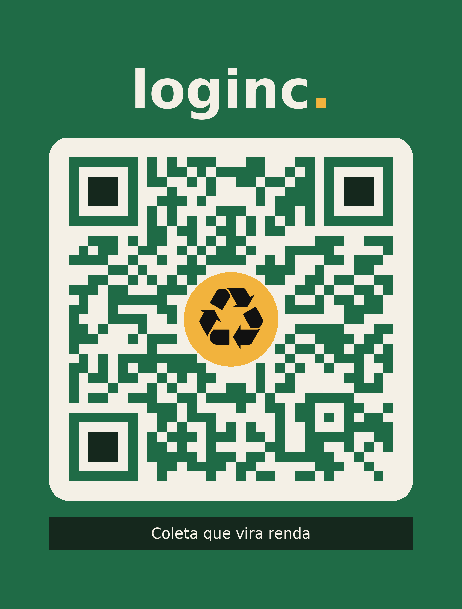

# Loginc

**Coleta que vira renda.** Plataforma de coleta seletiva que liga quem gera o resíduo, quem coleta, a Central de Triagem e a Prefeitura, com PEVs (pontos de entrega voluntária) que avisam sozinhos quando estão cheios.

Projeto criado no **Hackathon Estação Tecnológica 2026** (HUBINE/Banco do Nordeste, Estação Tecnológica de Quixadá e IFCE Campus Quixadá), para o desafio de **resíduos sólidos e coleta seletiva** da Prefeitura de Quixadá.

<p align="center">
  
</p>

**Demonstração ao vivo:** https://loginc.tailb54547.ts.net/pev

---

## O problema

A Prefeitura de Quixadá apresentou quatro desafios:

1. **Comunicação com a população:** falta equipe para chegar às pessoas.
2. **Falta de rota estruturada de coleta seletiva:** os catadores precisam de uma rota inteligente.
3. **Incentivos insuficientes:** só a consciência ambiental não faz as pessoas aderirem. O **IPTU Verde** (até 15% de desconto) já foi aprovado, mas ainda faltam os critérios, o cadastro e o monitoramento.
4. **Lixão e catadores:** a cidade está saindo do lixão, e os catadores que vivem lá precisam de renda fora dele.

## A solução

O Loginc fecha um ciclo em que todo mundo ganha:

```
 Empresa / escola ──avisa material──┐
                                    ├──> Catador aceita e segue a rota ──> Central de Triagem pesa
 PEV com sensor ──passou de 70%─────┘                                              │
                                                                                   ▼
                     Prefeitura acompanha o painel <── pontos de IPTU Verde (empresa)
                                                       Moeda Verde (catador)
```

1. **Empresa** (restaurante, comércio, escola) avisa que tem material separado: óleo, papelão, plástico, metal ou vidro.
2. **PEV com sensor** mede o próprio nível e, ao passar de 70%, cria o pedido de coleta sozinho.
3. **Catador** vê os pedidos no mapa, aceita e segue uma rota que sai da Central e volta para ela.
4. **Central de Triagem** pesa o material. **A balança da Central é o número oficial.** O peso gera:
   - **Moeda Verde** para o catador, usada como desconto nos comércios parceiros;
   - **pontos de IPTU Verde** para a empresa.
5. **Prefeitura** acompanha os kg desviados do lixão, o ranking das empresas com selo verde, o desconto calculado, a simulação do impacto no orçamento, o status dos PEVs e um relatório de evidências para o IQM.

**Diferencial:** o catador comprova o incentivo. A coleta confirmada e pesada na Central é a prova para o IPTU Verde, e isso resolve o monitoramento sem a prefeitura precisar de equipe própria.

A solução cobre as três dimensões da sustentabilidade: **ambiental** (material fora do lixão e óleo fora do esgoto), **social** (renda e inclusão dos catadores) e **econômica** (desconto para empresas e saldo positivo para o orçamento municipal).

---

## O que foi implementado

### Protótipo web (`prototipo/`)

App em React, num único arquivo HTML que funciona offline. Os dados ficam no `localStorage` do navegador. Cada perfil tem a sua tela:

| Perfil | O que dá para fazer |
|---|---|
| **Catador** | Cadastro guiado (foto, nome, WhatsApp, associação e senha de 4 números), com leitura em voz alta e opção de texto grande. Pedidos no mapa de Quixadá, rota pelo vizinho mais próximo saindo da Central, aceite e confirmação de coleta. Carteira de Moeda Verde com extrato e uso de desconto nos parceiros, com código de resgate. |
| **Empresa** | Cadastro com CNPJ, pedido de coleta (material, quantidade e observação), parceria com os catadores, pontos, selo (Bronze, Prata ou Ouro), desconto no IPTU Verde e histórico. |
| **PEVs** | Três PEVs com a lata animada e a leitura do sensor em cm. O PEV ligado à ESP32 mostra a lata enchendo ao vivo, e ao passar de 70% o pedido de coleta é criado sozinho. |
| **Central** | Fila de pesagem: o peso real credita o catador e a empresa. Estoque por material e venda em lote. |
| **Prefeitura** | Kg desviados, litros de óleo, renda dos catadores, ranking de empresas com selo e desconto, status dos PEVs, simulação de renúncia fiscal × economia com coleta e aterro, e relatório para o IQM. |

**Regras de negócio do MVP:**

- Empresa: 1 ponto por kg pesado e 2 pontos por litro de óleo. 20 pontos valem 1% de desconto no IPTU Verde, quem é parceiro dos catadores ganha +2%, e o teto é 15%, como na lei municipal.
- Selos: Bronze a partir de 50 pontos, Prata a partir de 150 e Ouro a partir de 300.
- Catador: 10 Moeda Verde (MV) por kg pesado. 1 MV vale cerca de R$ 0,10 em descontos, e cada uso consome 50 MV.
- Prefeitura: renúncia = IPTU de cada empresa × percentual de desconto; economia anual = toneladas do período × 12 × custo por tonelada de coleta e aterro (padrão de R$ 150/t, editável).

Todos os dados são fictícios, conforme a LGPD e o edital.

### PEV inteligente (`iot/`)

Protótipo físico com **ESP32 + sensor ultrassônico HC-SR04** dentro de uma caixa. A placa mede a distância até o lixo, calcula o nível e envia para o servidor por HTTPS. A página `/pev` mostra a lata enchendo em tempo real.

- **Leitura robusta:** 15 disparos por medição, com o 2º eco mais próximo, porque papel amassado e sacola nem sempre devolvem o som. Um filtro assimétrico faz o lixo aparecer na hora, mas só baixa o nível depois de várias leituras seguidas.
- **Calibração:** o nível é medido do fundo até a borda da caixa (100% = lixo na borda), com zona morta para o ruído do fundo.
- **Resiliência:** reconexão automática do Wi-Fi, conexão TLS reaproveitada entre envios e watchdog que reinicia a placa se o loop travar.
- **Diagnóstico pelo monitor serial:** quando não há eco, a placa testa o pino ECHO e varre os pinos vizinhos para achar fio fora do lugar. Quando o Wi-Fi falha, lista as redes de 2,4 GHz visíveis.

Ligação:

```
HC-SR04 VCC  -> VIN/5V da ESP32
HC-SR04 GND  -> GND
HC-SR04 TRIG -> GPIO 32
HC-SR04 ECHO -> divisor -> GPIO 34

   ECHO --[1 kΩ]--+--> GPIO 34
                  |
                [2 kΩ]
                  |
                 GND
```

O divisor é obrigatório: o ECHO sai em 5V e a ESP32 aceita 3,3V.

### Servidor (`servidor/`)

`servidor.py` usa só a biblioteca padrão do Python 3, sem dependências:

- serve o protótipo; as rotas de perfil (`/catador`, `/empresa`, `/pev`, `/central` e `/prefeitura`) abrem direto, e a demonstração completa (`/`) pede senha;
- `POST /api/sensor` recebe a leitura da ESP32, autenticada por token (`Authorization: Bearer`);
- `GET /api/sensor` devolve a última leitura de cada PEV, consultada pela página a cada 1 s;
- página comprimida com gzip e cache com ETag, para abrir rápido em conexões lentas.

---

## Como testar

### 1. Online, sem instalar nada

Abra https://loginc.tailb54547.ts.net/pev ou leia o QR code acima. Os outros perfis ficam em `/catador`, `/empresa`, `/central` e `/prefeitura`.

Roteiro sugerido (cerca de 2 min):

1. **Empresa:** a pizzaria pede a coleta de óleo.
2. **PEVs:** ligue o sensor automático, ou encha a caixa de verdade, e veja o PEV passar de 70% e criar um pedido.
3. **Catador:** aceite os pedidos, veja a rota e confirme a coleta.
4. **Central:** pese o material. A Moeda Verde e os pontos sobem.
5. **Catador:** use um desconto num parceiro.
6. **Prefeitura:** feche no painel.

### 2. Só o protótipo, offline

Abra `prototipo/loginc.html` direto no navegador. Tudo funciona com o sensor simulado no app. Para recomeçar do zero, use o botão de reiniciar a demonstração.

### 3. Servidor local com o sensor

Requer Python 3.10 ou mais novo.

```bash
cd servidor
cp ../prototipo/loginc.html .

# senha da demonstração completa (/)
python3 -c "import hashlib,secrets; s=secrets.token_bytes(16); \
h=hashlib.scrypt(b'troque-esta-senha', salt=s, n=2**14, r=8, p=1, dklen=32); \
open('senha.hash','w').write(s.hex()+':'+h.hex())"

python3 servidor.py          # porta 8770; use PORTA=xxxx para trocar
```

Na primeira execução são criados `segredo.key` (assina os cookies) e `sensor.token` (o token da ESP32). Nenhum dos dois é versionado.

Abra http://127.0.0.1:8770/pev e, em outro terminal, simule o sensor:

```bash
LOGINC_URL=http://127.0.0.1:8770 SENSOR_TOKEN=$(cat servidor/sensor.token) ./iot/simulador/simular.sh
```

A lata do PEV "Escola Campo Novo" (`v2`) enche de 10% a 90% e esvazia. Use `PEV=v1` ou `PEV=v3` para os outros PEVs.

Também dá para mandar uma leitura avulsa:

```bash
curl -X POST http://127.0.0.1:8770/api/sensor \
  -H "Authorization: Bearer $(cat servidor/sensor.token)" \
  -H 'Content-Type: application/json' \
  -d '{"pev": "v2", "distancia_cm": 8, "altura_cm": 30}'
```

### 4. Com o hardware

1. Monte a ligação acima.
2. Copie `iot/pev_esp32/segredos.exemplo.h` para `iot/pev_esp32/segredos.h` e preencha a rede Wi-Fi (2,4 GHz) e o token de `servidor/sensor.token`.
3. Em `pev_esp32.ino`, ajuste `URL` para o seu servidor, `PEV_ID` e a calibração da caixa (`ALTURA_CM` com a caixa vazia e `DIST_CHEIO_CM` com o lixo na borda).
4. Grave com a Arduino IDE (placa "ESP32 Dev Module", core ESP32 3.x) e abra o monitor serial em 115200.

O sketch envia a cada 1 s para a demonstração. Em campo, o intervalo previsto é de 15 minutos (`INTERVALO_MS = 900000`).

---

## Estrutura do repositório

```
prototipo/
  loginc.html                  app completo num arquivo (abre offline)
  fonte/loginc.template.html   marcação e lógica do app, legíveis
servidor/
  servidor.py                  servidor HTTP + API do sensor
iot/
  pev_esp32/pev_esp32.ino      firmware da ESP32
  pev_esp32/segredos.exemplo.h modelo para Wi-Fi e token
  simulador/simular.sh         simula a ESP32 sem hardware
docs/qrcode/                   QR code da demonstração e o script que o gera
```

## Tecnologias

- **Front-end:** React 18, HTML e CSS, em arquivo único, com `localStorage`.
- **Back-end:** Python 3 (biblioteca padrão: `http.server`, `hashlib.scrypt`, HMAC).
- **IoT:** ESP32, HC-SR04, Arduino (C++), HTTPS.
- **Publicação:** Tailscale Funnel.

## Próximos passos

- Piloto com 3 PEVs e 10 empresas.
- Rede celular (NB-IoT/LTE-M) onde não houver Wi-Fi e alimentação solar no PEV.
- Banco de dados no servidor no lugar do `localStorage`, com login por perfil.
- Avisos pelo WhatsApp para os catadores.
- Abatimento da Moeda Verde na conta de água, se o serviço for municipal.
- Relatório mensal automático para a prefeitura e evidências para o IQM e para os créditos de reciclagem.

## Uso de inteligência artificial

Conforme o edital, declaramos o uso de IA neste projeto:

- **Claude (Anthropic):** apoio na análise do desafio e da legislação (IPTU Verde, IQM/ICMS, créditos de reciclagem), na escrita do código do protótipo web, do servidor e do firmware da ESP32, na geração do QR code e na redação deste README.
- **Whisper (OpenAI, modelo aberto):** transcrição dos áudios das conversas com a Prefeitura e com os mentores.

As decisões de produto, as regras de negócio, a montagem e a calibração do hardware, os testes e a validação com os stakeholders foram feitos pela equipe. Todo o código foi revisado e testado pela equipe, e todos os dados usados são fictícios.

## Equipe

| Nome | Curso |
|---|---|
| José Wagner Marques Fernandes Junior | Sistemas de Informação · UFC |
| Levi Gomes Ferreira | Engenharia de Software · UFC |
| Francisco Yuri Rodrigues da Silva | Química · IFCE |
| Ana Amélia Oliveira Ribeiro | Engenharia de Produção Civil · IFCE |
